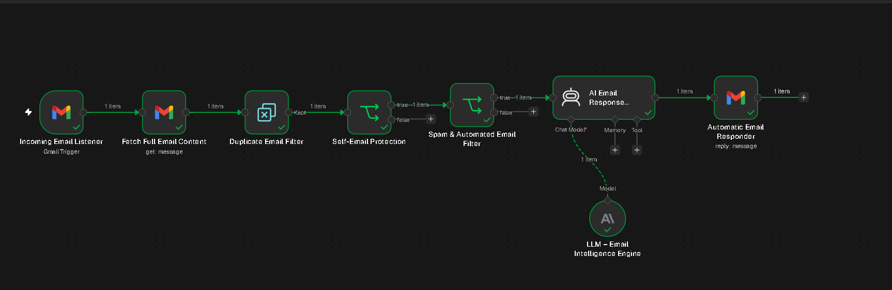
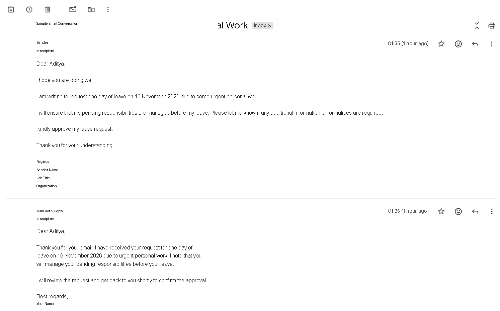

# MailPilot AI 🤖

### AI-Powered Intelligent Email Automation System

MailPilot AI is an intelligent email automation system built using **n8n, Gmail, and Anthropic Claude**. It automatically analyzes incoming emails, understands their intent, and generates context-aware professional replies.

## 🚀 Features

- Automatic incoming email detection
- Full email content extraction
- Duplicate email filtering
- Self-email protection
- Spam and automated email filtering
- AI-powered email understanding
- Context-aware professional reply generation
- Automatic Gmail replies within the original email thread

## 🛠️ Tech Stack

- **Automation:** n8n
- **AI Model:** Anthropic Claude Haiku 5.5
- **Email Integration:** Gmail API
- **AI Workflow:** n8n AI Agent

## ⚙️ Workflow Architecture

1. Incoming Email Listener
2. Fetch Full Email Content
3. Duplicate Email Filter
4. Self-Email Protection
5. Spam & Automated Email Filter
6. AI Email Response Generator
7. Automatic Email Responder

## 🏗️ Project Architecture

MailPilot AI follows a sequential automation pipeline:

1. **Email Monitoring:** Gmail Trigger detects incoming emails every minute.
2. **Email Extraction:** Gmail retrieves the complete email content.
3. **Duplicate Detection:** Previously processed emails are filtered out.
4. **Self-Email Protection:** Emails sent from the configured account are excluded.
5. **Spam Filtering:** Spam and automated emails are blocked.
6. **AI Processing:** Anthropic Claude analyzes the email's intent and context.
7. **Reply Generation:** The AI generates a concise, professional response.
8. **Email Delivery:** Gmail sends the response within the original email thread.

**Architecture Flow:**

`Gmail → Email Extraction → Duplicate Filter → Security Filters → AI Agent → Claude → Gmail Reply`

## 📸 Workflow Overview



## 💬 AI-Generated Email Reply
MailPilot AI analyzes incoming emails and generates context-aware professional replies automatically.



## 📂 Project Structure

```text
MailPilot-AI/
├── README.md
├── workflow/
│   └── mailpilot-workflow.json
└── screenshots/
    └── workflow-overview.png
```

## 🔧 Setup Instructions

1. Download the workflow JSON from this repository.
2. Import it into your n8n instance.
3. Configure your own Gmail credentials.
4. Configure your Anthropic API credentials.
5. Replace `YOUR_EMAIL@gmail.com` with your Gmail address in the self-email protection node.
6. Test the workflow with sample emails.
7. Activate the workflow after successful testing.

## 🔐 Security

- Never upload API keys, OAuth tokens, or passwords.
- Configure your own credentials after importing.
- Do not share private email content or personal information.

## 👨‍💻 Author

**Aditya Chauhan**

AI & Machine Learning Student

GitHub: [@Aditya1432s](https://github.com/Aditya1432s)

---

*Built with n8n, Gmail, and AI-powered automation.*
